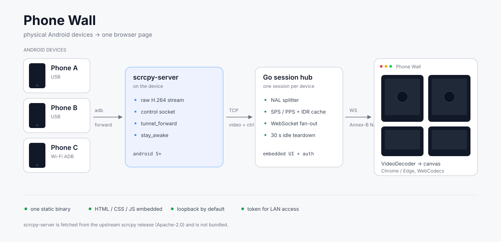

<div align="center">
  <h1>Phone Wall</h1>
  <p><strong>A wall of physical Android phones in your browser.</strong></p>
  <p>Live H.264 from <a href="https://github.com/Genymobile/scrcpy">scrcpy-server</a> · WebCodecs decoding · multi-device grid · one Go binary</p>

  <p>
    <a href="https://github.com/TwitterIsGood/phone-wall/actions/workflows/ci.yml"></a>
    <a href="https://github.com/TwitterIsGood/phone-wall/releases/latest"></a>
    
    <a href="LICENSE"></a>
  </p>

  <p>English · <a href="README.zh-CN.md">简体中文</a></p>
</div>

Phone Wall turns USB or Wi-Fi connected Android devices into one self-hosted browser page. Every tile is a live, interactive screen: tap, swipe, Back / Home / Recents, and type text. It talks to `scrcpy-server` directly and decodes H.264 with the browser's WebCodecs API. There is no desktop client, no front-end build step, and no cloud service.



## Features

- **A real grid, not one device at a time.** `/grid` shows every phone side by side; each tile is independently controllable. `/` is a focused single-device view.
- **One shared session per device.** Every viewer of the same phone shares one scrcpy encoder. The latest SPS/PPS + IDR is cached and replayed to new connections, so a fresh tab paints immediately. The session is torn down 30 seconds after the last viewer leaves.
- **60 fps single view, efficient tiles.** The focused view requests 60 fps at native resolution; tiles ask for 30 fps and at most 1440 px to keep a large wall cheap.
- **Input over the scrcpy control channel.** Touch, keys and text are injected through the same socket as the video, with HTTP fallbacks for devices without a control channel. Clicking a tile captures the physical keyboard for that device only.
- **Old-device fallback.** If `scrcpy-server` cannot start (for example on an Android 6 OPPO A57), Phone Wall falls back to `screenrecord` plus `adb input` instead of showing a black tile.
- **Zero-config discovery.** Without a config file, devices are discovered with `adb devices -l`; USB and wireless entries of the same phone are merged by `ro.serialno`, and tiles are named after the model.
- **Rename and status.** Rename a tile from the UI (`names.json`), and see online/offline state at a glance.
- **Localized UI.** English, Simplified Chinese, Japanese and Vietnamese, with automatic browser detection, a manual language menu, and a `?lang=` override. No build step, no external assets.
- **Safe defaults.** Loopback-only by default; a token is mandatory before binding to a LAN address. Mutations are POST-only and WebSockets are same-origin.
- **One static binary.** The HTML, CSS and JS are embedded with `go:embed`; the only runtime dependencies are `adb` and the `scrcpy-server` jar.

## Requirements

- Go 1.24+ to build, or a binary from [Releases](https://github.com/TwitterIsGood/phone-wall/releases).
- `adb` on `PATH` (Android platform-tools).
- **scrcpy-server** 5.x. It ships with [scrcpy](https://github.com/Genymobile/scrcpy/releases); Phone Wall looks for it next to `scrcpy`, in the WinGet package layout, or in the working directory. You can also pass `--scrcpy-jar`.
- A Chromium-based browser with WebCodecs (Chrome / Edge). Other browsers need `VideoDecoder` support.
- Android 5.0+ devices with USB debugging or wireless debugging enabled.

## Quick start

```bash
git clone https://github.com/TwitterIsGood/phone-wall
cd phone-wall

adb devices                 # make sure the phones are authorized
go run . --scrcpy-jar /path/to/scrcpy-server
```

Open **http://127.0.0.1:8765/grid**.

If `devices.json` does not exist, the devices are discovered automatically. To give them stable names and an order, create the file:

```json
{
  "devices": [
    {"key": "pixel-1", "name": "Pixel 8", "serials": ["R58M123456A", "192.0.2.25:5555"]},
    {"key": "pixel-2", "name": "Pixel 8", "serials": ["R58M654321B"]},
    {"key": "oppo",    "name": "OPPO A57", "serials": ["0123456789ABCDEF"]}
  ]
}
```

`serials` are tried in order, so a device reachable over both USB and wireless debugging can list both. See [`devices.example.json`](devices.example.json).

### Expose it on your LAN

```bash
./phone-wall --host 0.0.0.0 --token "a-long-random-token"
```

Open `http://<host>:8765/?token=a-long-random-token` once. Phone Wall sets an HttpOnly cookie and redirects to a clean URL. Scripts can instead send `X-Auth-Token` or `Authorization: Bearer <token>`.

> **Phone Wall speaks plain HTTP and has no TLS.** The token protects the UI, not the wire. Use it on a trusted LAN, or put it behind WireGuard / Tailscale / an HTTPS reverse proxy. Never expose it directly to the internet.

## How it works

```
 phones ──USB / Wi-Fi ADB──► adb forward ──► scrcpy-server (H.264)
                                                   │
                                        Go session hub (one per device)
                                                   │  WebSocket, Annex-B NALs
                                        browser VideoDecoder ──► canvas
```

For each device, Phone Wall starts `scrcpy-server` with `tunnel_forward=true`, `raw_stream=true`, `control=true` and a per-session `scid`. It opens two TCP connections through the same `adb forward`: one for video, one for control. Video bytes are split into Annex-B NAL units, the latest keyframe group is cached, and each viewing browser receives the NALs over a WebSocket. The browser builds the `avcC` description from SPS/PPS and feeds `EncodedVideoChunk`s to `VideoDecoder`; decoded frames are drawn to a `<canvas>`.

Touch and key events use scrcpy's binary control protocol (32-byte inject-touch, 14-byte inject-keycode). Text uses inject-text for printable ASCII and set-clipboard + paste for everything else. When the control channel is unavailable, the client falls back to `POST /tap`, `/swipe`, `/key` and `/text`, which call `adb shell input`.

### Typing text

Click a tile in the grid (or the video in single view) to make it the keyboard target; a blue outline shows which device will receive keys, and only that device's WebSocket is used. Printable ASCII, <kbd>Backspace</kbd>, <kbd>Delete</kbd>, <kbd>Enter</kbd>, <kbd>Tab</kbd> and the arrow keys are captured; <kbd>Esc</kbd> releases the device. The <kbd>⌨</kbd> button opens a per-tile text field for multi-character input (handy on mobile browsers and with an IME); its Send and ⏎ buttons send the whole string.

Printable ASCII goes through scrcpy's `INJECT_TEXT`, split at 300 bytes per message. Non-ASCII text (Chinese, emoji, …) cannot be turned into key events by scrcpy's `KeyCharacterMap`, so Phone Wall writes it to the device clipboard with scrcpy's `SET_CLIPBOARD` message and presses `KEYCODE_PASTE`. This overwrites the Android clipboard — any app on the phone can read it, so avoid pasting secrets that way.

When a device has no control channel (the `screenrecord` fallback), `POST /text` uses `adb shell input text`, which is **ASCII-only** (spaces become `%s`). For non-ASCII text on such a device, install and select the [ADB Keyboard](https://github.com/senzhk/ADBKeyBoard) IME (`com.android.adbkeyboard`); Phone Wall then sends its `ADB_INPUT_TEXT` broadcast. If it is not selected, the endpoint returns `501` with an explanation.

## Configuration

### Localization

The UI ships with English (`en`), Simplified Chinese (`zh-CN`), Japanese (`ja`) and Vietnamese (`vi`). `Auto` follows `navigator.languages`; a manual choice is remembered in `localStorage`. A query such as `?lang=ja` or `?lang=vi` overrides it and is remembered as well.

All strings live in [`i18n.js`](i18n.js). To add a language, add an entry with the same keys as `en` and a native `name`; the menu picks it up automatically. `node tools/check-i18n.js` verifies that every locale has the same keys and no empty values.

### Files

| File | Purpose |
| --- | --- |
| `devices.json` | Device list. Missing file = auto-discover with adb. Gitignored. |
| `names.json` | Display names written by the rename button. Gitignored. |

### Flags

| Flag | Default | Description |
| --- | --- | --- |
| `--host` | `127.0.0.1` | Listen address. A non-loopback address requires `--token`. |
| `--port` | `8765` | Listen port. |
| `--token` | `$PHONE_WALL_TOKEN` | Shared access token. |
| `--config` | `devices.json` | Device list file. |
| `--names` | `names.json` | Display-name overrides. |
| `--adb` | `$ADB` or `adb` | Path to the adb executable. |
| `--scrcpy-jar` | auto-detect | Path to the `scrcpy-server` jar. |
| `--scrcpy-version` | `5.0.1` | Version string passed to scrcpy-server. |
| `--clean-forwards` | `true` | Remove stale `scrcpy_*` adb forwards at startup. |
| `--version` | | Print the version and exit. |

### HTTP API

All mutating endpoints are `POST`. `/status` and `/frame/{key}` are read-only.

| Endpoint | Description |
| --- | --- |
| `GET /` | Single-device UI (`?dev=<key>`). |
| `GET /grid` | Multi-device grid. |
| `GET /devices` | `{"devices":[{"key","name"}]}`. |
| `GET /status` | `{"status":{"<key>":"device"\|"offline"}}`. |
| `GET /frame/{key}` | PNG snapshot, used to paint the first frame. |
| `GET /ws?dev={key}[&tile=1]` | H.264 over WebSocket; JSON text for input. |
| `POST /key/{key}?k=back\|home\|recents\|enter\|del\|tab\|dpad_up\|…\|wake` | Key event. |
| `POST /tap/{key}?x=&y=&fw=&fh=` | Tap in frame coordinates. |
| `POST /swipe/{key}?x1=&y1=&x2=&y2=&d=&fw=&fh=` | Swipe. |
| `POST /text/{key}?t=` | Fallback text injection when there is no control channel. ASCII via `adb input text`; non-ASCII via the ADB Keyboard IME broadcast (`501` if it is not selected). |
| `POST /rename/{key}?name=` | Set or clear a display name. |

## Limitations

- **Video only.** Audio is not captured or forwarded.
- **Single pointer.** Tap, drag and swipe work; pinch-to-zoom / two-finger gestures do not.
- **Non-ASCII text uses the clipboard.** With a control channel it is pasted via `SET_CLIPBOARD` + `KEYCODE_PASTE`, which replaces the phone's clipboard. Without a control channel, Unicode needs the ADB Keyboard IME; `adb shell input text` alone is ASCII-only.
- **Fallback is slower.** Devices that cannot run a modern scrcpy server use `screenrecord`: about 30 fps and roughly a second of latency.
- **Wireless debugging is not persistent.** Most phones must re-enable it after a reboot; Phone Wall then marks the device offline.
- **This is a viewer/controller, not a device farm platform.** No app install, file transfer, device allocation or user management. If you need those, look at [DeviceFarmer/STF](https://github.com/DeviceFarmer/stf).
- **`--clean-forwards` is global.** It removes every stale `localabstract:scrcpy_*` forward on startup, so do not run two instances that are expected to keep separate sessions.

## Responsible use

Use Phone Wall only with devices you own or are explicitly authorized to control. Automating multiple accounts can violate the terms of service of the apps you use; this project does not provide evasion features and is not intended for abuse.

## Acknowledgements

- [scrcpy](https://github.com/Genymobile/scrcpy) by Genymobile — the device-side server and control protocol (Apache-2.0). Phone Wall does not bundle the jar; install it from the upstream release.
- [gorilla/websocket](https://github.com/gorilla/websocket) — WebSocket implementation (BSD-3-Clause).
- The WebCodecs API for in-browser H.264 decoding.

## License

[MIT](LICENSE) © 2026 TwitterIsGood
