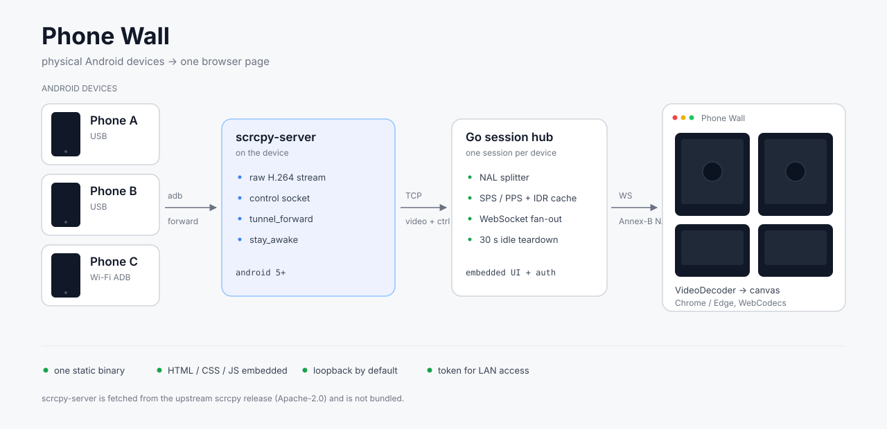

<div align="center">
  <h1>Phone Wall</h1>
  <p><strong>把一排实体安卓手机放进浏览器。</strong></p>
  <p>scrcpy-server 实时 H.264 · WebCodecs 硬解 · 多设备平铺 · 单个 Go 二进制</p>

  <p>
    <a href="https://github.com/TwitterIsGood/phone-wall/actions/workflows/ci.yml"></a>
    <a href="https://github.com/TwitterIsGood/phone-wall/releases/latest"></a>
    
    <a href="LICENSE"></a>
  </p>

  <p><a href="README.md">English</a> · 简体中文</p>
</div>

Phone Wall 把通过 USB 或无线 ADB 连接的安卓设备变成一个自托管的网页手机墙。每个格子都是实时画面，可以直接点按、滑动、按返回/主页/后台、输入文字。它直接驱动 `scrcpy-server`，用浏览器的 WebCodecs 解码 H.264；没有桌面客户端、没有前端构建步骤、没有云服务。



## 特性

- **真正的一屏多机。** `/grid` 平铺所有手机，每个格子独立控制；`/` 是单台手机的专注视图。
- **同一设备共享一路会话。** 多个标签页 / 多个人看同一台手机只用一个 scrcpy 编码器；缓存最近的 SPS/PPS + IDR，新连接立刻出画面；最后一个观看者离开 30 秒后才回收。
- **单屏 60fps，平铺更省资源。** 单屏请求原生分辨率 60fps；格子请求 30fps、最长边 1440px。
- **输入走 scrcpy 控制通道。** 触摸、按键和文字都与视频共用同一路连接；点击格子会把物理键盘锁定到这台设备；控制通道不可用时自动回退到 HTTP 注入。
- **老设备兜底。** `scrcpy-server` 起不来时（例如 Android 6 的 OPPO A57）自动回退 `screenrecord` + `adb input`，不会留下黑屏。
- **零配置发现。** 没有配置文件时用 `adb devices -l` 自动发现；同一台手机的 USB 与无线条目会按 `ro.serialno` 合并，并按型号命名。
- **改名与状态。** 页面内改名（写入 `names.json`），在线/离线状态一目了然。
- **界面本地化。** 内置英文、简体中文、日语和越南语；自动跟随浏览器语言，也可在页面里手动切换，或用 `?lang=` 指定。无外部资源、无构建步骤。
- **默认安全。** 默认只监听 `127.0.0.1`；绑定局域网地址必须提供 token；所有写操作只接受 POST，WebSocket 校验同源。
- **单文件部署。** HTML/CSS/JS 通过 `go:embed` 打进二进制；运行时只依赖 `adb` 和 `scrcpy-server`。

## 环境要求

- Go 1.24+，或直接下载 [Releases](https://github.com/TwitterIsGood/phone-wall/releases) 里的二进制。
- `adb` 在 `PATH` 中（Android platform-tools）。
- **scrcpy-server** 5.x（随 [scrcpy](https://github.com/Genymobile/scrcpy/releases) 发布）。Phone Wall 会尝试在 `scrcpy` 同级目录、WinGet 安装目录和当前目录查找，也可以 `--scrcpy-jar` 指定。
- 支持 WebCodecs 的 Chromium 内核浏览器（Chrome / Edge）。
- Android 5.0+，已开启 USB 调试或无线调试。

## 快速开始

```bash
git clone https://github.com/TwitterIsGood/phone-wall
cd phone-wall

adb devices                 # 确认手机已授权
go run . --scrcpy-jar /path/to/scrcpy-server
```

打开 **http://127.0.0.1:8765/grid**。

没有 `devices.json` 时会自动发现设备。想要固定名称和顺序，就创建：

```json
{
  "devices": [
    {"key": "pixel-1", "name": "Pixel 8", "serials": ["R58M123456A", "192.0.2.25:5555"]},
    {"key": "pixel-2", "name": "Pixel 8", "serials": ["R58M654321B"]},
    {"key": "oppo",    "name": "OPPO A57", "serials": ["0123456789ABCDEF"]}
  ]
}
```

`serials` 按顺序尝试，所以一台同时支持 USB 和无线调试的手机可以两个都列上。参考 [`devices.example.json`](devices.example.json)。

### 暴露到局域网

```bash
./phone-wall --host 0.0.0.0 --token "一段足够长的随机串"
```

第一次用 `http://<主机>:8765/?token=...` 打开；Phone Wall 会写入 HttpOnly cookie 并跳转到不带 token 的地址。脚本也可以直接发 `X-Auth-Token` 或 `Authorization: Bearer <token>`。

> **Phone Wall 是明文 HTTP，没有 TLS。** token 保护的是界面访问，不是传输链路。请只在可信局域网使用，或放在 WireGuard / Tailscale / HTTPS 反向代理后面。不要直接暴露到公网。

## 工作原理

```
 手机 ──USB / 无线 ADB──► adb forward ──► scrcpy-server（H.264）
                                                │
                                     Go 会话中心（每设备一路）
                                                │  WebSocket，Annex-B NAL
                                     浏览器 VideoDecoder ──► canvas
```

每台设备以 `tunnel_forward=true`、`raw_stream=true`、`control=true` 和独立的 `scid` 启动 `scrcpy-server`，通过同一个 `adb forward` 打开视频和控制两条 TCP 连接。服务端把字节流切成 Annex-B NAL，缓存最近的关键帧组，再通过 WebSocket 发给浏览器。浏览器用 SPS/PPS 构造 `avcC`，把 NAL 封装成 `EncodedVideoChunk` 交给 `VideoDecoder`，解码帧直接画到 `<canvas>`。

触摸和按键使用 scrcpy 的二进制控制协议（32 字节 inject-touch、14 字节 inject-keycode）。文字走 inject-text（可打印 ASCII），其他字符则用 set-clipboard + 粘贴。控制通道不可用时，前端回退到 `POST /tap`、`/swipe`、`/key`、`/text`，由服务端调用 `adb shell input`。

### 输入文字

在平铺页点击某个格子（单屏页点击画面）后，该设备成为键盘目标：蓝色边框标明按键会发往哪台手机，并且只走那台设备的 WebSocket。可打印 ASCII、<kbd>退格</kbd>、<kbd>Delete</kbd>、<kbd>回车</kbd>、<kbd>Tab</kbd> 和方向键都会被捕获；<kbd>Esc</kbd> 释放设备。点击 <kbd>⌨</kbd> 按钮会打开该格子的文字输入框，适合手机浏览器和输入法多字符输入；发送和 ⏎ 按钮会一次发送整段文字。

可打印 ASCII 通过 scrcpy 的 `INJECT_TEXT` 发送，每条最多 300 字节。中文、emoji 等非 ASCII 字符无法被 scrcpy 的 `KeyCharacterMap` 转成按键事件，因此 Phone Wall 用 `SET_CLIPBOARD` 控制消息写入设备剪贴板，再发送 `KEYCODE_PASTE` 粘贴。这会覆盖手机剪贴板——手机上的任何应用都能读到，请不要用这种方式粘贴密码等敏感内容。

设备没有控制通道（回退到 `screenrecord`）时，`POST /text` 使用 `adb shell input text`，**只支持 ASCII**（空格写成 `%s`）。这类设备要输入非 ASCII 文字，需要安装并切换到 [ADB Keyboard](https://github.com/senzhk/ADBKeyBoard) 输入法（`com.android.adbkeyboard`），Phone Wall 会改发它的 `ADB_INPUT_TEXT` 广播；没有切换时接口返回 `501` 并说明原因。

## 配置

### 界面语言

内置英文（`en`）、简体中文（`zh-CN`）、日语（`ja`）和越南语（`vi`）。`自动` 跟随 `navigator.languages`，手动选择会记在 `localStorage`；`?lang=ja`、`?lang=vi` 等参数可以覆盖并记住选择。

所有文案都在 [`i18n.js`](i18n.js)：新增一个与 `en` 键名一致、带本地语言 `name` 的对象即可，菜单会自动出现。`node tools/check-i18n.js` 会校验各语言键是否齐全、是否有空值。

### 文件

| 文件 | 用途 |
| --- | --- |
| `devices.json` | 设备列表；文件不存在则用 adb 自动发现。已 gitignore。 |
| `names.json` | 页面改名写入的显示名称。已 gitignore。 |

### 命令行参数

| 参数 | 默认值 | 说明 |
| --- | --- | --- |
| `--host` | `127.0.0.1` | 监听地址；非回环地址必须同时提供 `--token`。 |
| `--port` | `8765` | 监听端口。 |
| `--token` | `$PHONE_WALL_TOKEN` | 共享访问 token。 |
| `--config` | `devices.json` | 设备列表文件。 |
| `--names` | `names.json` | 显示名称覆盖文件。 |
| `--adb` | `$ADB` 或 `adb` | adb 可执行文件路径。 |
| `--scrcpy-jar` | 自动查找 | `scrcpy-server` jar 路径。 |
| `--scrcpy-version` | `5.0.1` | 传给 scrcpy-server 的版本号。 |
| `--clean-forwards` | `true` | 启动时清理残留的 `scrcpy_*` adb forward。 |
| `--version` | | 打印版本后退出。 |

### HTTP API

所有写操作都是 `POST`；`/status` 和 `/frame/{key}` 是只读的。

| 接口 | 说明 |
| --- | --- |
| `GET /` | 单设备界面（`?dev=<key>`）。 |
| `GET /grid` | 多设备平铺。 |
| `GET /devices` | `{"devices":[{"key","name"}]}`。 |
| `GET /status` | `{"status":{"<key>":"device"\|"offline"}}`。 |
| `GET /frame/{key}` | PNG 快照，用于首帧。 |
| `GET /ws?dev={key}[&tile=1]` | WebSocket 传 H.264；文本消息承载输入。 |
| `POST /key/{key}?k=back\|home\|recents\|enter\|del\|tab\|dpad_up\|…\|wake` | 按键。 |
| `POST /tap/{key}?x=&y=&fw=&fh=` | 按画面坐标点击。 |
| `POST /swipe/{key}?x1=&y1=&x2=&y2=&d=&fw=&fh=` | 滑动。 |
| `POST /text/{key}?t=` | 没有控制通道时的文字兜底。ASCII 走 `adb input text`；非 ASCII 走 ADB Keyboard 广播（未切换该输入法时返回 `501`）。 |
| `POST /rename/{key}?name=` | 设置或清除显示名称。 |

## 限制

- **只有画面，没有声音。**
- **单指操作。** 点击、拖动、滑动可用；双指缩放/多指手势不支持。
- **非 ASCII 文字走剪贴板。** 有控制通道时通过 `SET_CLIPBOARD` + `KEYCODE_PASTE` 粘贴，会覆盖手机剪贴板。没有控制通道时，中文等需要 ADB Keyboard 输入法；`adb shell input text` 本身只支持 ASCII。
- **回退模式更慢。** 不能运行新版 scrcpy-server 的设备使用 `screenrecord`，约 30fps、延迟约 1 秒。
- **无线调试不持久。** 多数手机重启后要重新打开；之后 Phone Wall 会把它标为离线。
- **这是投屏/控制器，不是设备农场平台。** 不提供装应用、传文件、设备分配、用户管理；需要这些请用 [DeviceFarmer/STF](https://github.com/DeviceFarmer/stf)。
- **`--clean-forwards` 是全局的。** 启动时会清掉所有残留的 `localabstract:scrcpy_*` forward，不要同时跑两个需要各自保持会话的实例。

## 使用边界

请只控制你拥有或明确获授权控制的设备。批量操作多账号可能违反所使用平台的服务条款；本项目不提供规避检测的功能，也不面向滥用场景。

## 致谢

- [scrcpy](https://github.com/Genymobile/scrcpy)（Genymobile）— 设备端服务与控制协议（Apache-2.0）。本项目不打包 jar，请从上游发布页获取。
- [gorilla/websocket](https://github.com/gorilla/websocket) — WebSocket 实现（BSD-3-Clause）。
- 浏览器 WebCodecs API 提供 H.264 解码。

## 许可证

[MIT](LICENSE) © 2026 TwitterIsGood
